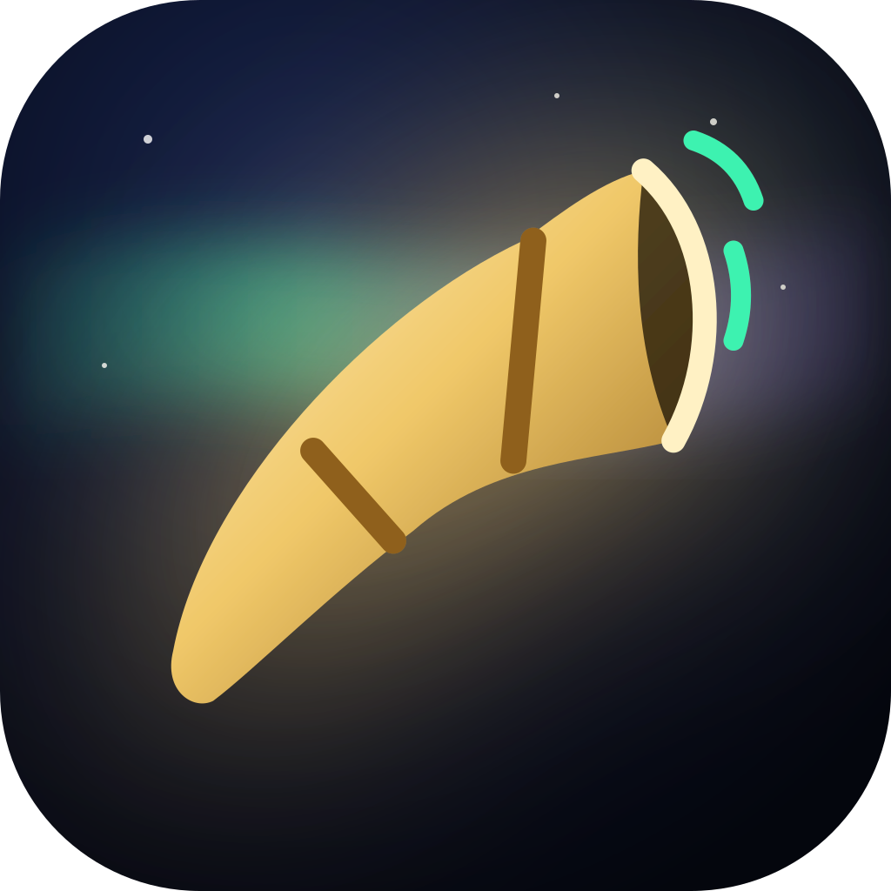
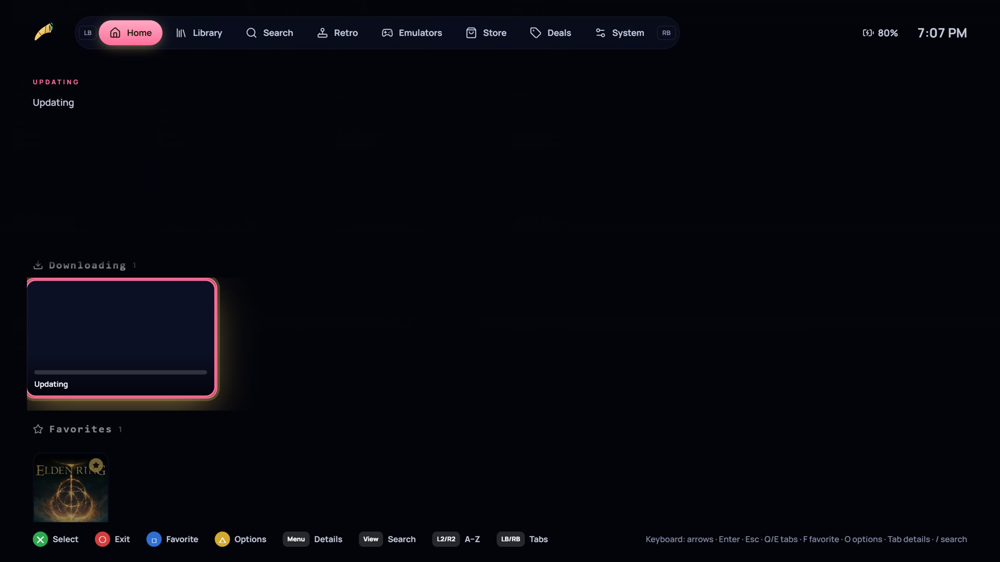
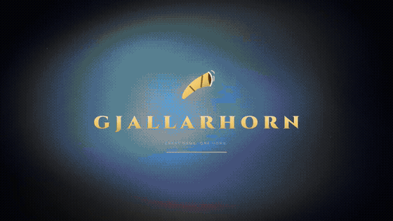
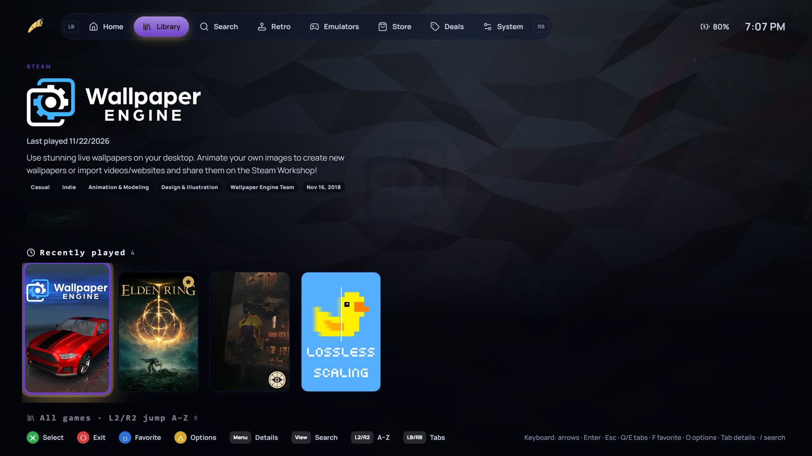
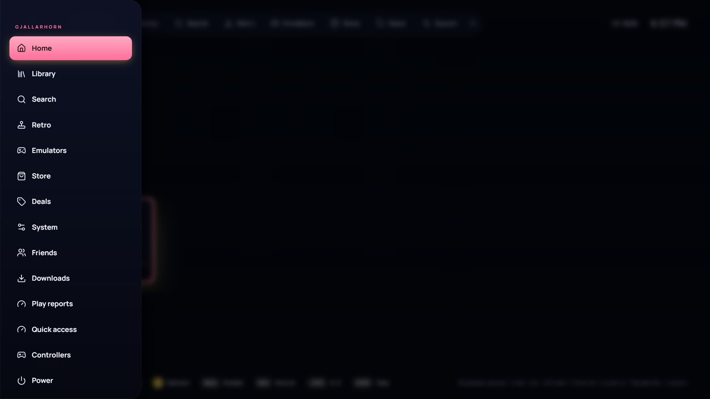
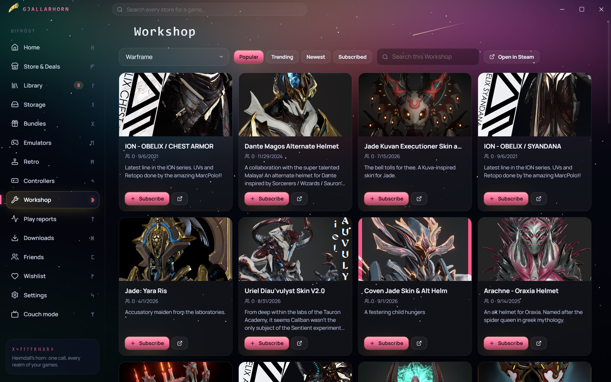
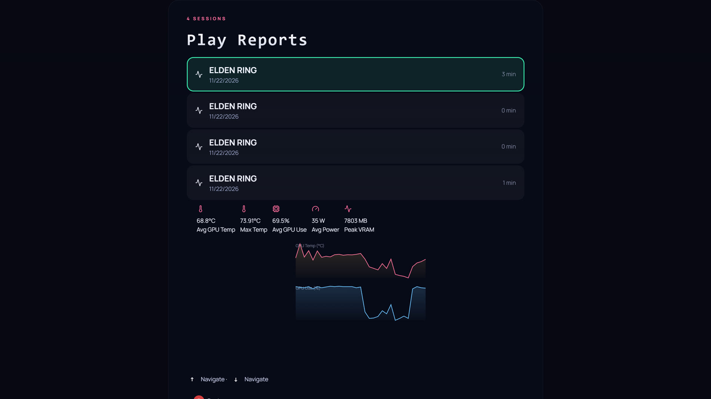
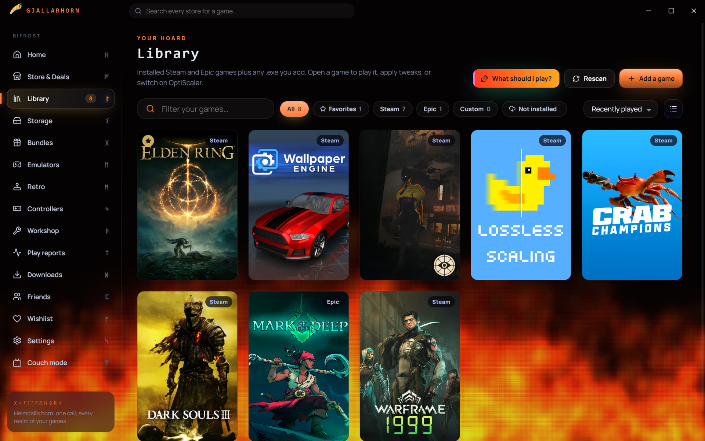
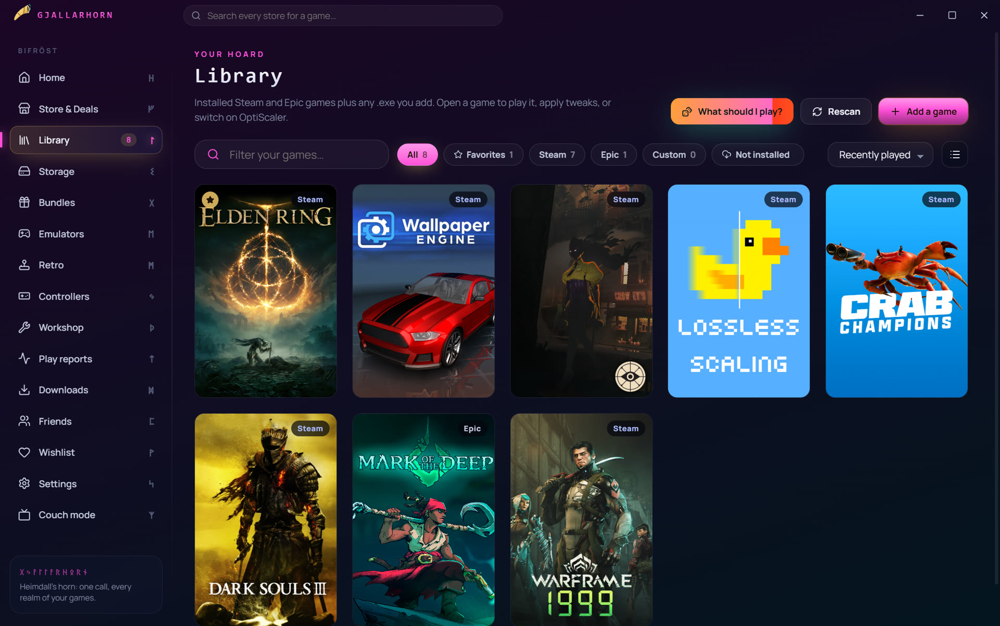

<div align="center">



# GJALLARHORN

### One launcher for every game. Built for the couch.

A free, open-source Windows game launcher and **Big-Picture-style couch mode** that brings Steam, Epic, GOG, Ubisoft, EA, Battle.net, Riot and your emulators into one fast, controller-first, endlessly customisable front end.

[**Download**](../../releases/latest) · [**Get started**](docs/GETTING-STARTED.md) · [**Features**](docs/FEATURES.md) · [**Controls**](docs/CONTROLS.md) · [**FAQ**](docs/FAQ.md) · [**Architecture**](docs/ARCHITECTURE.md) · [**Website**](https://KaeghanG.github.io/gjallarhorn/)


<br />



<br />

<a href="docs/trailer.mp4"></a>

<sub>Click the animation to watch the full trailer (<a href="docs/trailer.mp4">docs/trailer.mp4</a>).</sub>

</div>

---

## Why "Gjallarhorn"?

In Norse myth the **Gjallarhorn** is the horn of the watchman Heimdall, the call that echoes across all nine realms when Ragnarök begins. In **Destiny** it became something else: the legendary rocket launcher everyone wanted and everyone remembers. This project is a small tribute to that name. The author loved *the best launcher named Gjallarhorn* so much that they set out to build a **fire launcher** with the same name, one that calls every game you own with a single, glorious blast.

> Gjallarhorn is an independent fan project. It is **not** affiliated with or endorsed by Bungie, Valve, Epic Games, or any store. No Bungie assets are used; the war-horn logo is an original drawing.

---

## What is it?

Gjallarhorn is a desktop app with **two faces**:

| | Desktop app | Couch mode |
|---|---|---|
| **For** | Mouse + keyboard | Controller on the big screen |
| **Looks** | Classic sidebar app with rich pages | Full-screen "10-foot" UI, trailers, big tiles |
| **Open it** | Start the app | Sidebar, *Couch mode*, or hold **Back + Start** |

Your games still launch through their own stores (Steam must be running for Steam games, the Epic launcher for Epic games). Gjallarhorn is the beautiful, unified **front end**. It does not replace the stores; it replaces *looking at five different launchers*.

---

## A quick tour

<table>
<tr>
<td width="50%"><br/><sub><b>Library</b>: every store in one place, collections, recently played, A-Z jumping with L2/R2.</sub></td>
<td width="50%"><br/><sub><b>Sidebar</b>: press Left on the first tile for the Big-Picture-style menu.</sub></td>
</tr>
<tr>
<td width="50%"><br/><sub><b>Steam Workshop</b>: browse, search and subscribe without opening a browser.</sub></td>
<td width="50%"><br/><sub><b>Play reports</b>: GPU temperature, use, power and VRAM for every session.</sub></td>
</tr>
<tr>
<td width="50%"><br/><sub><b>Fire theme</b>: a live flame background and your own accent colour.</sub></td>
<td width="50%"><br/><sub><b>Presets</b>: Neon, Terminal, Muspelheim, Frost Giant and more in one click.</sub></td>
</tr>
</table>

More in the **[full feature guide](docs/FEATURES.md)**.

---

## Features

### Libraries and launching
- **Every store, one library.** Steam (all library folders), Epic Games (classic *and* the newer per-user launcher), GOG, Ubisoft Connect, EA app, Battle.net, Riot, non-Steam shortcuts, custom `.exe` games and emulated games.
- **Owned but not installed.** See what you own on Steam and Epic and install it from the app. Fortnite is always offered for Epic.
- **Launch options that matter.** Per-game launch arguments with a curated list of performance flags.
- **Always the right GPU.** On hybrid laptops Gjallarhorn sets Windows' *High performance* GPU preference for itself and every game and emulator it launches, so nothing silently lands on the integrated chip.

### Couch mode (controller first)
- **Cinematic home** with hero art, logos and trailer playback on hover.
- **Shelves and collections:** Favorites, Recently played, Needs update, per-store rows, alphabetical *Not installed* row.
- **Per-game Options (Y):** favourite, shelves, backups, achievements, Workshop/mods, launch options.
- **Quick access, Controllers, Power, Downloads, Play reports, Friends** one slide-out sidebar away.
- **Owns the screen.** Fullscreen, hides the Windows taskbar until you leave, closes Steam's own Big Picture window if it pops up, and returns to the front when your game closes.
- **Animated launch screen** with game art, embers and a pulsing *Now playing* state.

### In-game menu: hold **Back + Start**
Works anywhere a controller is plugged in: in a game, on the desktop, over an emulator.
**Resume game** (brings it back to the front) · **Gjallarhorn home** · **Friends & chat** · **Downloads** · **Volume** · **Brightness** · **Do Not Disturb** · **Screenshot** · **Close game** (graceful, then forced after 6 s) · **Sleep** · **Restart / shut down** · pending friend requests and game invites.

### Social
- **Friends & chat** on Steam's chat protocol: online / in-game list, presence with the real game name, messages with an on-screen keyboard, friend requests, one-press join-game. Sign in once with a QR code from the Steam mobile app. **Chat history is saved locally.**
- **Achievements** for Steam games, from your public profile, with no API key required.

### Mods and add-ons
- **Steam Workshop browser** (couch *and* desktop): Popular, Trending, Newest, Subscribed; thumbnails, descriptions, subscriber counts, one-press subscribe/unsubscribe, desktop search.

### Emulators and retro
- Auto-detects **Eden/yuzu-family (Switch), Dolphin, PCSX2, RPCS3, Cemu, Ryujinx, DuckStation, RetroArch** and more; scans ROM folders and launches with the right arguments.
- **Cover art finds itself:** libretro-thumbnails for most systems, a cached public title database for Switch.
- Gjallarhorn **never downloads ROMs, BIOS, firmware or keys.** Bring your own.

### Insight
- **Play reports:** GPU temperature, utilisation, power draw and peak VRAM, sampled during every session you start from Gjallarhorn, with charts.
- **Automatic save backups**, playtime tracking, and an optional *AI / Gaming* switch that unloads local Ollama models from VRAM while you play.

### Make it yours
- **Animated backgrounds:** Aurora & stars, **Fire**, Rising embers, your own image / GIF / MP4 / WebM, or a colour gradient.
- **Themes:** four realms, **12 one-click presets**, custom accent colour, background dimming and glass blur.
- **Fonts:** 12 text fonts and 14 heading fonts, plus text size from Small to Extra large, applied across the whole app.
- **Intro splash screens** for desktop start and couch mode: **Bifröst**, **Forge**, **Runes**, **Boot terminal**, **Minimal**, the original **Cinematic**, or none, with a live preview.

### Desktop extras
Price comparison across stores, free games, wishlist with price-drop alerts, bundles, storage manager, OptiScaler helper, per-game tweaks with backup/restore, a global quick launcher (Ctrl + Shift + Space), command palette, game roulette and a tray icon.

---

## How it works

1. **Discovery.** Gjallarhorn reads what your launchers already installed: Steam's app manifests, Epic's install list, the Windows registry entries of GOG / Ubisoft / EA / Battle.net, Riot's client file and your Steam shortcuts. It does not log in to any store.
2. **Launching.** Pressing **A** starts the game exactly as the store would (`steam://rungameid/...`, the Epic launcher link, or the game's executable). For games it launches, it also tracks the process so it can show play reports, back up saves, bring the game back to the front, and return to you when it closes.
3. **Controllers.** A small background process reads XInput (Xbox) and the Windows joystick API (PlayStation) so the controller keeps working even when another window has focus. That is how **Back + Start** opens the menu over a running game.
4. **Couch mode** is the same React app rendered full screen with a controller-first navigation model: rows of tiles, a tab bar, a slide-out sidebar, and pages that each receive controller input.
5. **Everything is local.** Settings, chat history, play reports and cached art live in `%APPDATA%\Gjallarhorn`.

---

## Gjallarhorn vs. Steam Big Picture

| | Steam Big Picture | Gjallarhorn |
|---|---|---|
| Steam library | Yes | Yes |
| Epic, GOG, Ubisoft, EA, Battle.net, Riot in the same UI | No | **Yes** |
| Emulated games with auto cover art | Manual non-Steam shortcuts | **Detected, scanned, art fetched** |
| Menu over a running game | Guide button (Steam overlay) | **Hold Back + Start, also over emulators and the desktop** |
| Steam friends and chat | Yes | Yes (on-screen keyboard, saved history) |
| Steam Workshop | Via Steam | Browse and subscribe in-app |
| Themes, fonts, animated backgrounds, splash screens | Limited | **12 presets, fire/embers/video backgrounds, 26 fonts, 5 intros** |
| Play reports with GPU charts | No | **Yes** |
| Hides the Windows taskbar | Yes | Yes |
| Open source | No | **Yes (MIT)** |

Gjallarhorn is a front end and needs the stores it launches games through; it does not replace Steam's download, DRM or cloud systems.

---

## Documentation

| Guide | What's inside |
|---|---|
| [Getting started](docs/GETTING-STARTED.md) | Install, first launch, API key, couch mode, chat, emulators |
| [Feature guide](docs/FEATURES.md) | Every feature, page by page, with screenshots |
| [Controls](docs/CONTROLS.md) | Every button on every screen, keyboard shortcuts |
| [Emulators](docs/EMULATORS.md) | Supported systems, emulators, cover art |
| [Settings reference](docs/SETTINGS.md) | Every setting and its stored key |
| [FAQ](docs/FAQ.md) | Safety, stores, controllers, privacy |
| [Troubleshooting](docs/TROUBLESHOOTING.md) | Symptom-by-symptom fixes |
| [Architecture](docs/ARCHITECTURE.md) | Code map for contributors |
| [Roadmap](ROADMAP.md) · [Changelog](CHANGELOG.md) · [Contributing](CONTRIBUTING.md) | Where it's going and how to help |

---

## Under the hood

- **Electron 45** (main + sandboxed preload with a typed IPC bridge), **React 19**, **Vite**, **framer-motion**, **lucide-react**
- **steam-user** for Steam chat and the Workshop subscription session
- A PowerShell watcher for XInput / winmm controllers and for hiding the taskbar
- **electron-builder** (NSIS) for the Windows installer
- Light on dependencies: no analytics, no UI kit, no database

## Controller cheat sheet

| Input | Action |
|---|---|
| **A** | Select / play |
| **B** | Back / exit |
| **X** | Favourite |
| **Y** | Options menu |
| **LB / RB** | Previous / next tab |
| **L2 / R2** | Jump A-Z |
| **View (Back)** | Search |
| **Menu (Start)** | Game details |
| **Left** on the first tile | Open the sidebar |
| **Hold Back + Start** | Open the menu (anywhere) |

PlayStation pads work too (Share is Back, Options is Start). Keyboard in couch mode: arrows, **Enter**, **Esc**, **Q/E** for tabs, **F** favourite, **O** options, **/** search.

---

## Install

1. Download **`Gjallarhorn-Setup-x.y.z.exe`** from the [latest release](../../releases/latest) and run it.
2. Windows SmartScreen may warn because the installer is **not code-signed** yet: *More info, then Run anyway*.
3. Optional but recommended: in **Settings, Store accounts** paste a free [Steam Web API key](https://steamcommunity.com/dev/apikey) to unlock *Owned games* and the **Workshop browser**.

### Build from source
```bash
git clone https://github.com/KaeghanG/gjallarhorn.git
cd gjallarhorn
npm install
npm run dev         # run with hot reload
npm run package     # build the Windows installer into release/
```
Requires Node.js 20+ and Windows 10/11 (the controller layer and several features use PowerShell, XInput and Win32).

---

## Privacy and safety
- **Everything stays on your PC.** Settings, chat history and session reports live in the app's user-data folder. There is no account, analytics or telemetry.
- Network calls go only to the services you use: Steam, CheapShark prices, libretro-thumbnails, GitHub raw (Switch title database) and your stores' own launchers.
- API keys you paste are stored locally.
- **No piracy.** Gjallarhorn does not download, host or help find ROMs, BIOS files, firmware or keys.

## Known limits
- Windows only.
- Steam's own "Steam Input" per-game prompt comes from Steam, not Gjallarhorn; Steam remembers your answer per game.
- GPU reports need an NVIDIA GPU (`nvidia-smi`).
- Steam Workshop downloads are performed by Steam itself, so Steam must be running.
- The installer is unsigned.

## Contributing
Issues and pull requests are welcome. Start with **[docs/ARCHITECTURE.md](docs/ARCHITECTURE.md)** for a map of the code. Keep changes focused, test in both desktop and couch mode, and never commit API keys, personal paths or copyrighted game assets.

## Credits
Built with Electron, React, Vite, framer-motion, lucide-react and steam-user. Covers from [libretro-thumbnails](https://github.com/libretro-thumbnails) and the community Switch title database. Fonts: Manrope and Cinzel. Inspired by Heimdall's horn, and by a certain rocket launcher.

## License
[MIT](LICENSE)

<div align="center"><sub><b>Sound the horn.</b></sub></div>
