# Gjallarhorn: Feature Guide

Everything Gjallarhorn does, page by page. For a code map see [ARCHITECTURE.md](ARCHITECTURE.md).

**Related guides:** [Getting started](GETTING-STARTED.md) · [Controls](CONTROLS.md) · [Emulators](EMULATORS.md) · [Settings reference](SETTINGS.md) · [FAQ](FAQ.md) · [Troubleshooting](TROUBLESHOOTING.md)

**Contents:** [Libraries and launching](#libraries-and-launching) · [Couch mode](#couch-mode) · [Sidebar](#sidebar) · [In-game menu](#in-game-menu) · [Friends and chat](#friends-and-chat) · [Steam Workshop](#steam-workshop) · [Achievements](#achievements) · [Downloads](#downloads) · [Quick access](#quick-access) · [Controllers](#controllers) · [Play reports](#play-reports) · [Emulators and cover art](#emulators-and-cover-art) · [Themes, fonts and backgrounds](#themes-fonts-and-backgrounds) · [Splash screens](#splash-screens) · [Desktop extras](#desktop-extras)

---

## Libraries and launching

Gjallarhorn scans your PC and shows every game in one place: **Steam** (every library folder), **Epic Games** (both the classic launcher and the newer per-user launcher), **GOG Galaxy**, **Ubisoft Connect**, **EA app**, **Battle.net**, **Riot** games, **non-Steam shortcuts**, and **custom** games you add by hand. Emulated games live in their own tabs.

- **Installed vs owned.** Games you own but have not installed appear in a *Not installed* row (alphabetical). Steam needs your free Web API key for this list; Epic's list comes from the Epic launcher's own cache, and **Fortnite is always offered**. Pressing **A** starts the install: Steam games open Gjallarhorn's install screen (pick a library folder; if Steam does not react within a few seconds it opens Steam's own install dialog), Epic games open the Epic launcher's install page.
- **Launch options.** Each game can have its own launch arguments, with a curated list of performance flags to pick from.
- **Launch profiles.** Save named sets of launch arguments per game (for example *Windowed* or *Low latency*) and pick the active one; it is added when you press Play. Desktop: Library, open the game, *Launch profiles*. Couch: Options, *Launch profile...*.
- **Controller layout.** Per game, choose whether Back + Start opens Gjallarhorn's menu (turn it off for a game that uses both buttons), swap A and B in the menu, and tune stick sensitivity. These apply to Gjallarhorn's own menu; the game keeps full control of the controller, and true in-game button remapping is not offered.
- **The right GPU, always.** On laptops with an integrated and a discrete GPU, Gjallarhorn sets Windows' *High performance* GPU preference for itself and for every game and emulator it launches.
- **Updates.** Steam games with an update queued show an "Update queued" note and appear in the *Needs update* collection.

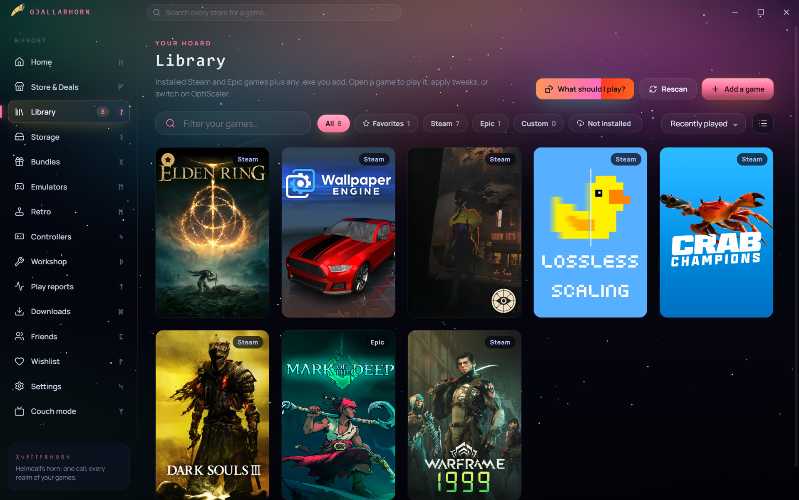

**How to open:** desktop sidebar → **Library**; couch mode → **Library** tab.

**Limits:** games run through their own stores, so Steam must be running for Steam games and the Epic launcher for Epic games.

---

## Couch mode

A full-screen, controller-first "10-foot" interface, the spiritual successor to Steam's Big Picture. Games get cinematic heroes with logos, genre chips and Metacritic scores, and a **trailer starts playing** a moment after you rest on a game. Tiles zoom slowly, sounds confirm every move, and the whole thing works with **Xbox** (including the Guide button) and **PlayStation** (DualSense/DualShock) controllers or a keyboard.

- **Tabs** along the top: Home, Library, Search, Retro, Emulators, Store, Deals, System. Switch with **LB / RB**.
- **Shelves and collections:** Favorites, Recently played, Needs update and per-store rows, plus *Jump back in* on Home. **L2 / R2** jump through a list A to Z.
- **Per-game Options (Y):** favourite, add to a shelf, back up saves, achievements, Workshop, launch options.
- **Owns the screen:** it is fullscreen, hides the Windows taskbar until you leave, closes Steam's own Big Picture window if one pops up, and comes back to the front when your game closes.
- **Launch screen:** an animated "Launching..." then "Now playing" screen with the game's art.
- **System tab:** exit couch mode, Quick access, Power menu, Controllers, Downloads, Screenshots, text size, safe area, high contrast, idle slideshow and which screen couch mode opens on.

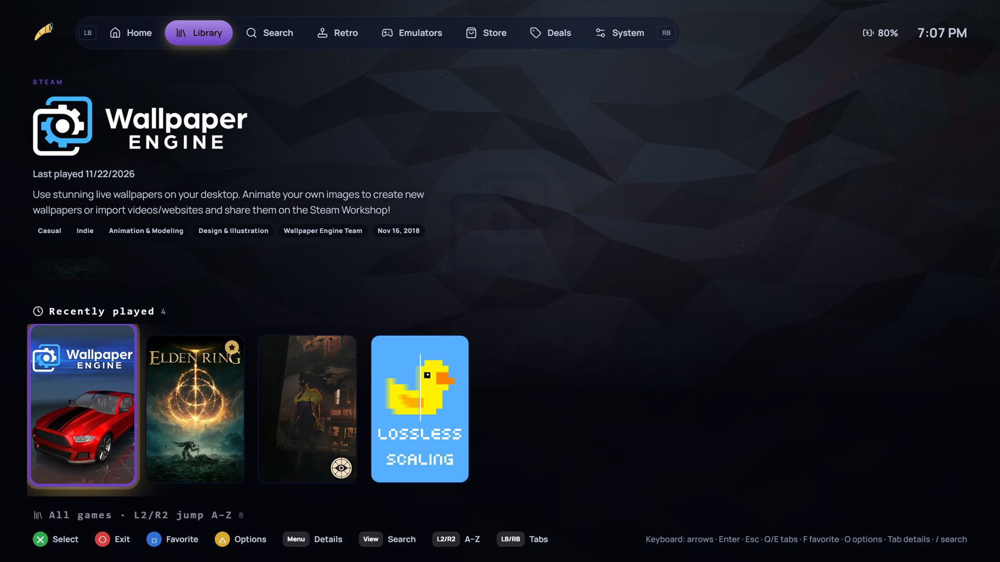
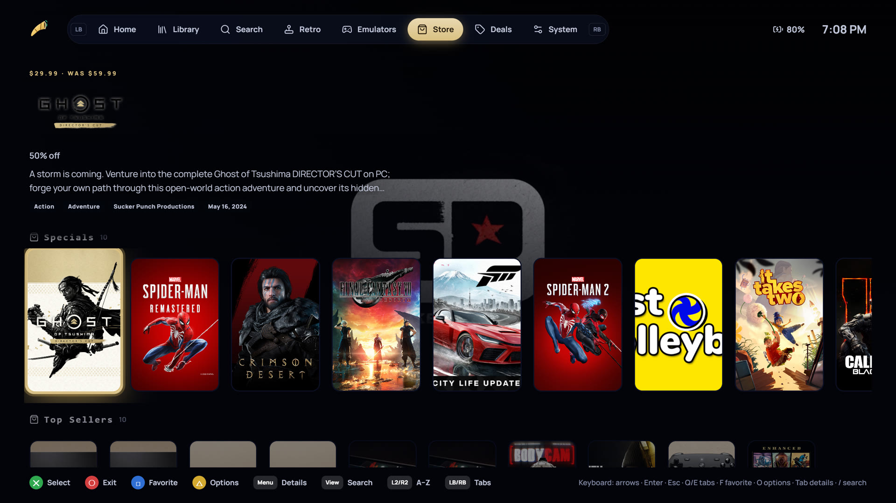

**How to open:** desktop sidebar → **Couch mode**, or hold **Back + Start** on a controller while Gjallarhorn is running.

**Keyboard:** arrows, **Enter**, **Esc**, **Q / E** switch tabs, **F** favourite, **O** options, **Tab** details, **/** search.

---

## Sidebar

On the first tile of any row, press **Left** to slide out the Big-Picture-style menu: **Home, Library, Search, Retro, Emulators, Store, Deals, System, Friends, Downloads, Play reports, Quick access, Controllers, Power**. **A** opens an entry; **B**, **Right** or **Y** closes it.

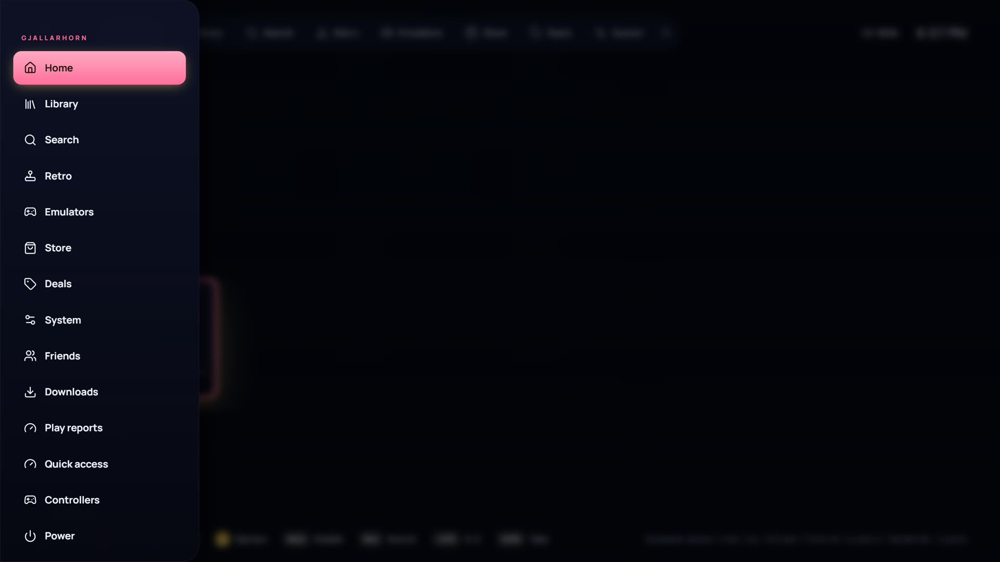

---

## In-game menu

**Hold Back + Start** (Share + Options on PlayStation) for about a second. It works with any controller plugged in: inside a game, on the desktop, or over an emulator.

| Item | What it does |
|---|---|
| **Resume game** | Closes the menu and brings the game window back to the front |
| **Gjallarhorn home** | Jumps to couch mode's Home, on top of the running game |
| **Friends & chat**, **Downloads** | Open those pages in couch mode |
| **Volume / Brightness** | Left / Right adjust, A mutes (brightness works on laptop screens) |
| **Do Not Disturb** | Toggles Windows notification suppression |
| **Take screenshot** | Saves a screenshot without the menu in it |
| **Start / stop clip recording** | Gives the game focus back and presses Windows Game Bar's record shortcut (Win + Alt + R); needs Xbox Game Bar enabled |
| **Close game** | Asks the game to close; force-closes it after 6 seconds if it ignores you |
| **Sleep PC**, **Restart / shut down...** | Power actions (restart and shut down ask for confirmation) |
| Pending invites | Accept friend requests and join game invites |

With no game running the same menu opens as **Menu** (with *Close menu* in place of *Resume*). In couch mode with no game, the same hold jumps straight to Home. Back and Start by themselves still work normally; they only act on release, so a combo hold never triggers them.

---

## Friends and chat

Chat with your Steam friends from the couch or the desktop, no browser or Steam window needed.

- **Sign in once** by scanning a QR code with the Steam mobile app. Gjallarhorn keeps a refresh token on your PC and signs in again by itself.
- **Friends list** grouped into online (including in-game, showing the real game name) and offline, with unread counts and friend requests you can accept or decline.
- **Chat** with an on-screen keyboard in couch mode (a normal text box on the desktop). **Chat history is saved locally** (up to 500 messages per friend) so conversations survive restarts.
- **Couch controls:** Up / Down choose a friend, **A** opens chat, **Y** joins their game, **X** opens their Steam chat, **B** goes back.

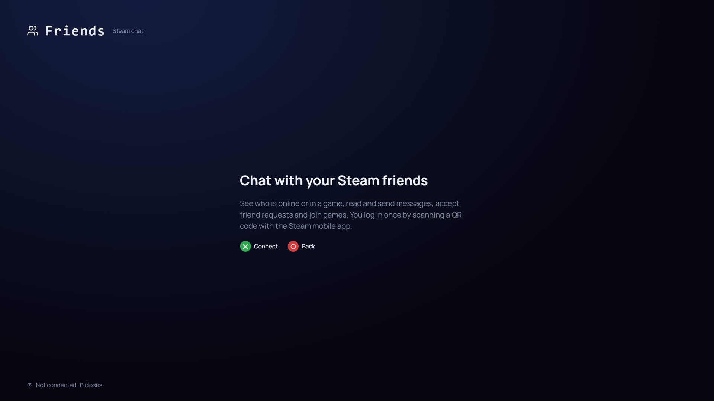

**Limits:** Steam must be installed; the first sign-in needs the Steam mobile app.

---

## Steam Workshop

Browse a game's Workshop and subscribe without opening a browser.

- **Couch:** pick a Steam game, press **Y**, choose **Workshop / mods**. **LB / RB** switch between Popular, Trending, Newest and Subscribed; Up / Down browse; **A** subscribes or unsubscribes; **X** opens the item in Steam; **Y** opens the game's Workshop home.
- **Desktop:** sidebar → **Workshop**: pick a game, choose a sort, search the Workshop, subscribe from the card.
- **How subscribing works:** Gjallarhorn uses your Steam chat login to subscribe in one press. If chat is not signed in (or Steam refuses), it opens the item in Steam so you can press Subscribe there. Steam does the actual download, usually the next time it checks (restart Steam if an item does not appear).
- Browsing needs your free [Steam Web API key](https://steamcommunity.com/dev/apikey) in **Settings → Store accounts**. Not every game has a Workshop.

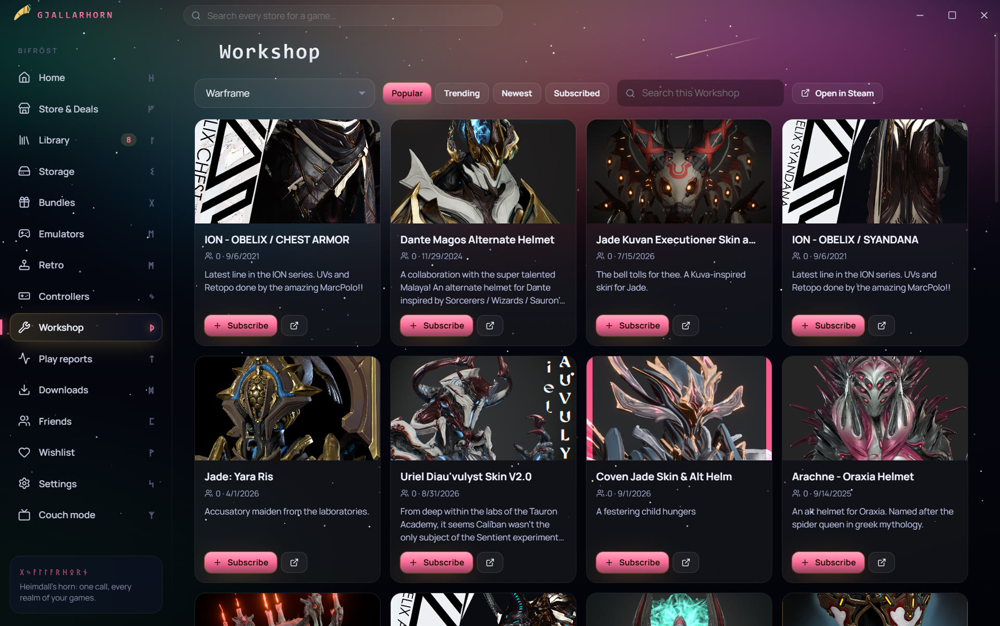

---

## Achievements

In couch mode, open a Steam game's **Options (Y) → Achievements** to see unlocked and locked achievements with icons, descriptions and unlock dates, plus a progress bar. It reads your **public Steam profile**, so no API key is needed; if your game details are private, set them to public in Steam's privacy settings.

---

## Downloads

Shows Steam games that are downloading, queued or waiting for an update, with progress, size and (when Steam reports it) speed. Gjallarhorn reads Steam's own files, so **Pause / Resume** opens Steam's download manager rather than controlling it directly.

**How to open:** couch sidebar or **System** tab → **Downloads**; desktop sidebar → **Downloads**.

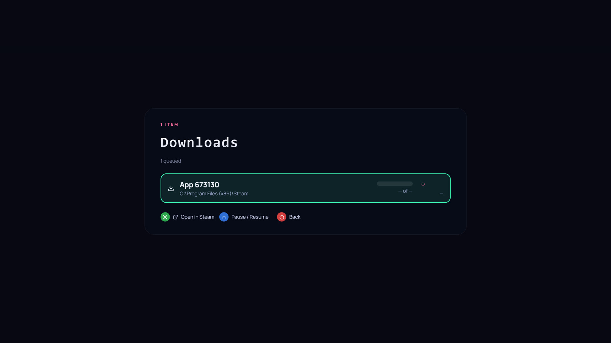

---

## Quick access

A page of live system vitals: **battery**, **Wi-Fi** name and signal, **volume** (adjustable), **CPU**, **GPU** (NVIDIA) and **RAM** usage. **How to open:** couch sidebar or System tab → **Quick access**.

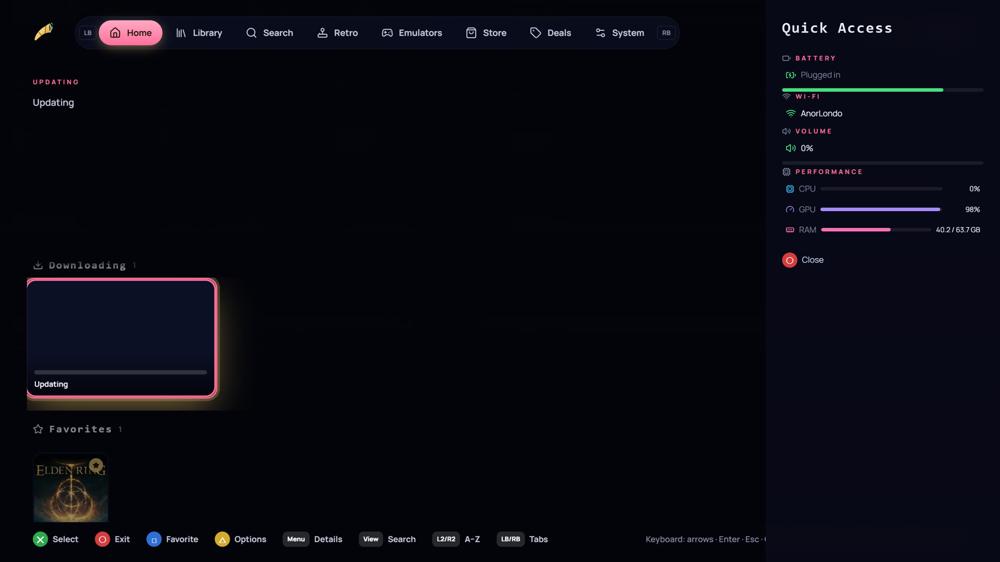

GPU readings need an NVIDIA GPU (`nvidia-smi`); they are blank on other GPUs.

---

## Controllers

Lists connected controllers (Xbox pads through XInput, PlayStation pads through the Windows joystick API) with their type and battery where Windows reports it, and a **button tester**: press **X** to enter test mode, then press buttons to see them register.

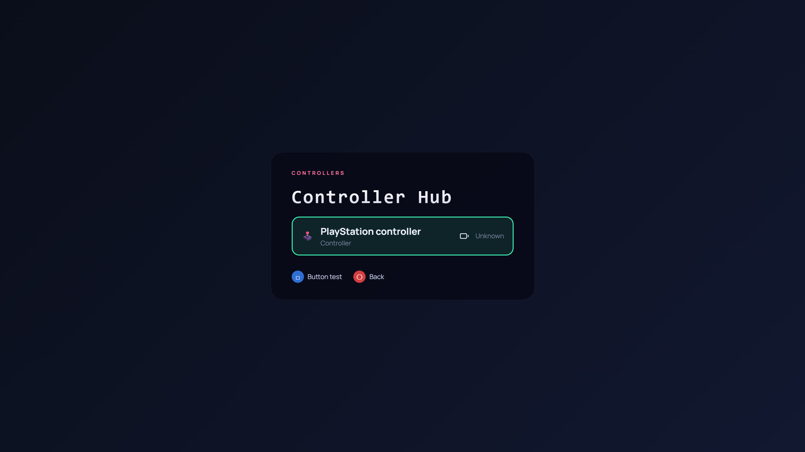

PlayStation pads show an "unknown" battery because Windows does not expose it.

---

## Screenshots and clips

One shelf for everything you capture: screenshots from Steam and Gjallarhorn, and video clips from Windows Game Bar, NVIDIA Instant Replay / ShadowPlay and Steam recordings. Filter by screenshots, clips or game, open a capture in a viewer (clips play in the app), copy a screenshot to the clipboard, or show it in its folder.

**How to open:** desktop sidebar → **Shots & clips**; couch sidebar → **Screenshots & clips**. Gjallarhorn does not record video itself; it lists what those tools save and can trigger Game Bar.

---

## Play reports

Every game you start from Gjallarhorn is tracked. When it closes you get a report with the session length and, on NVIDIA GPUs, **average and maximum temperature, average GPU use, average power and peak VRAM**, plus charts. Short sessions (a few minutes or less) have no charts.

A **Compare games** table at the bottom of the desktop page lines up time played, GPU use, temperature, power and VRAM across your games.

**How to open:** couch sidebar → **Play reports**; desktop sidebar → **Play reports**. Gjallarhorn also keeps playtime and can back up saves after a session.

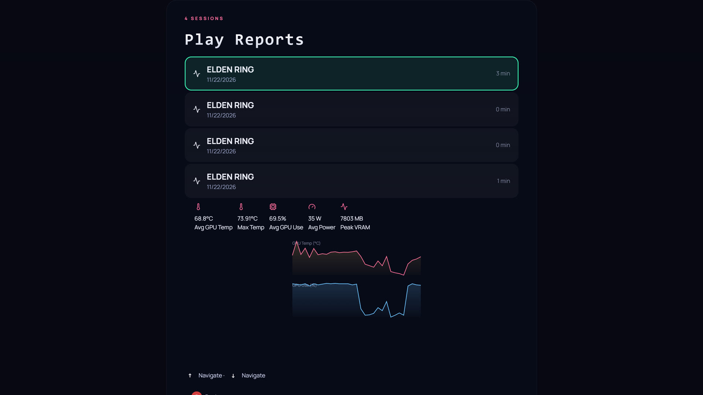
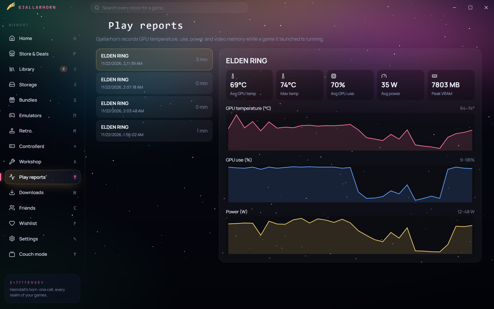

---

## Emulators and cover art

Gjallarhorn detects emulators you have installed (**Eden/yuzu-family for Switch, Dolphin, PCSX2, RPCS3, Cemu, Ryujinx, DuckStation, RetroArch** and more) and scans the ROM folders you choose, launching each ROM with the right emulator and arguments.

- **Covers find themselves:** libretro-thumbnails for most systems, and a public Switch title database for Switch games (downloaded once, then cached).
- **RetroAchievements:** add your username and web API key in **Settings, Launcher** to see your retro achievements on the Retro page.
- **It never downloads ROMs, BIOS files, firmware or keys.** Supply your own.

See [EMULATORS.md](EMULATORS.md) for every supported system and emulator.

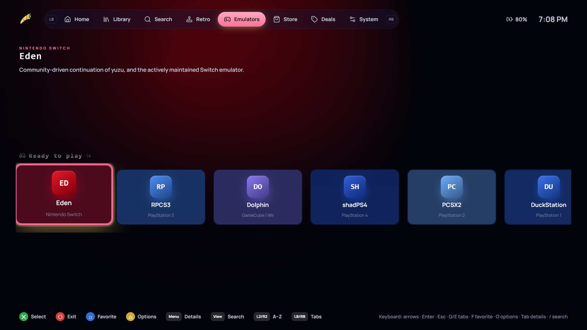

---

## Themes, fonts and backgrounds

**Settings → Theme & background** (desktop):

- **12 one-click presets:** Asgard, Muspelheim, Ember Hall, Frost Giant, Valkyrie, Midnight, Jungle, Blood Moon, Terminal, Paper, Neon, Mono.
- **Backgrounds:** Aurora and stars (default), **Fire**, **Rising embers**, your **own image / GIF / MP4 / WebM**, or a **colour gradient**.
- **Accent colour**, background **darkening**, and **glass blur**.
- **Fonts:** 12 text fonts and 14 heading fonts, and text size from Small to Extra large. Changes apply everywhere, including the store.
- The older **Realm** picker (Asgard, Niflheim, Muspelheim, Vanaheim) is still there.

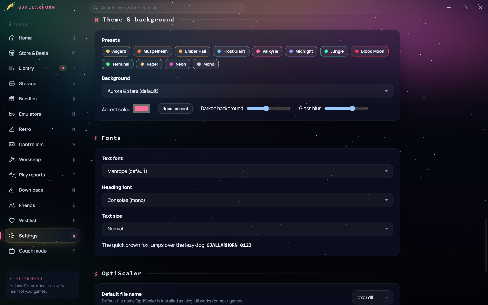
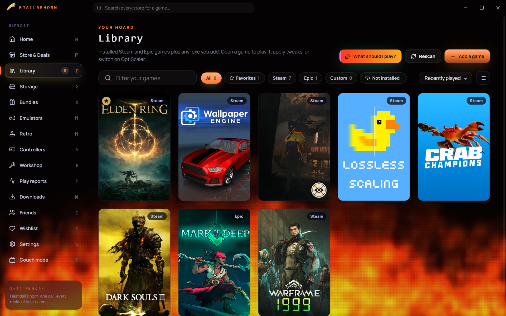
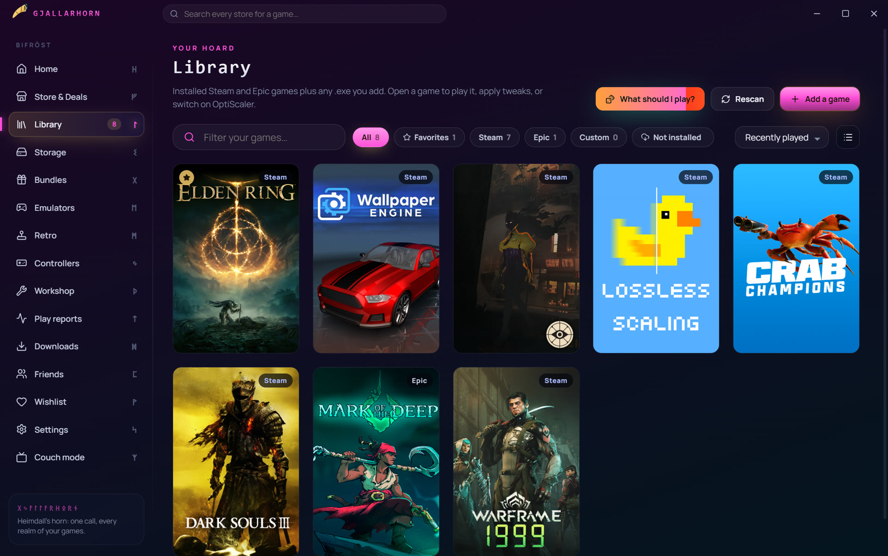
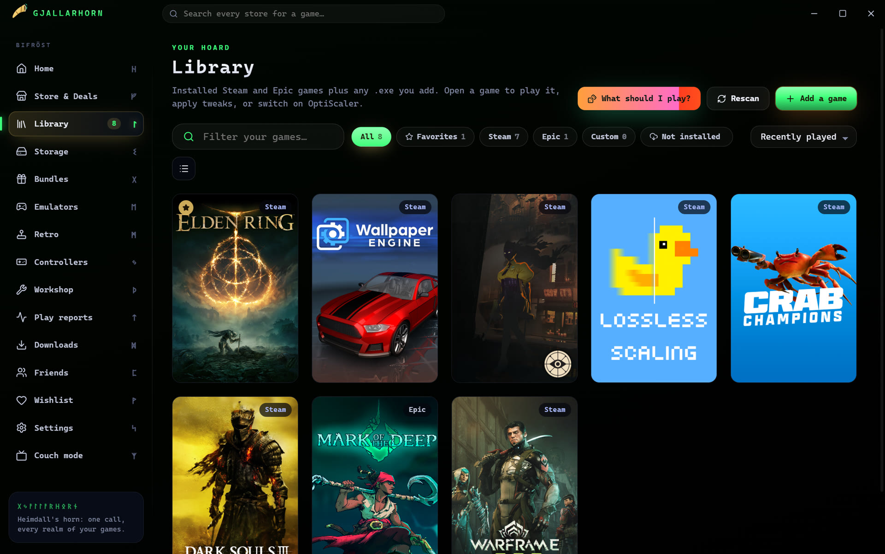

---

## Splash screens

Pick the intro that plays when the app starts and when you enter couch mode (**Settings → Couch mode intro**, with a Preview button): **Bifröst** (a rainbow bridge draws itself), **Forge** (hammer strike and sparks), **Runes**, **Boot terminal**, **Minimal**, the original **Cinematic**, or **None**. Any key or click skips it.

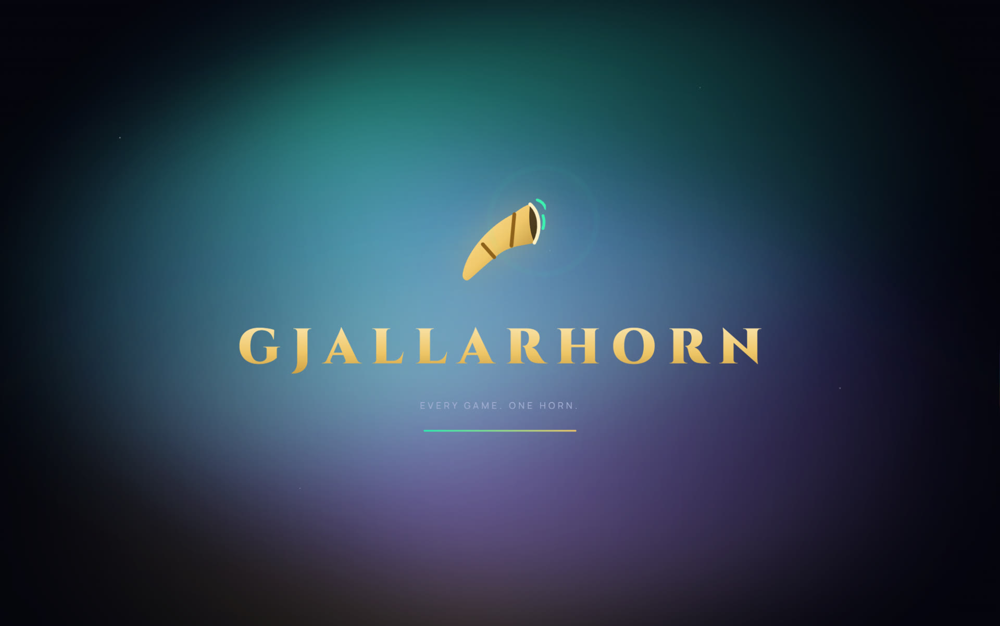
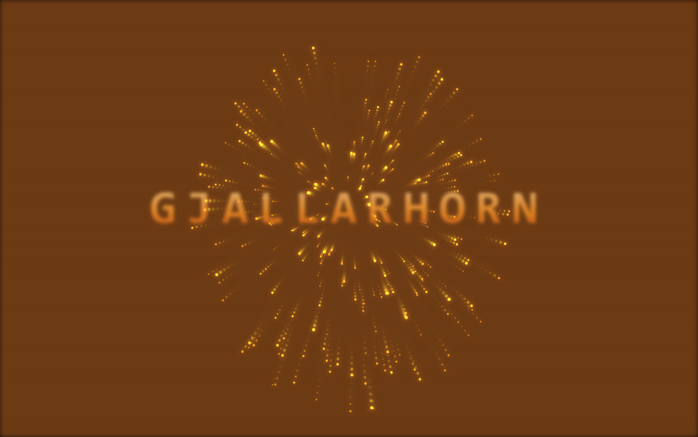
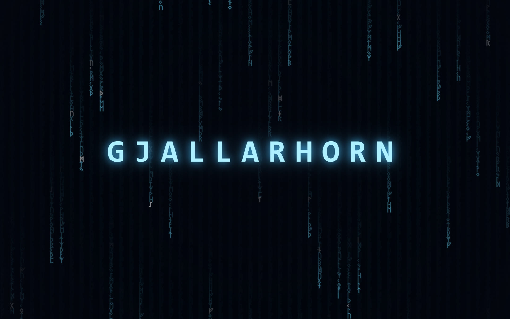
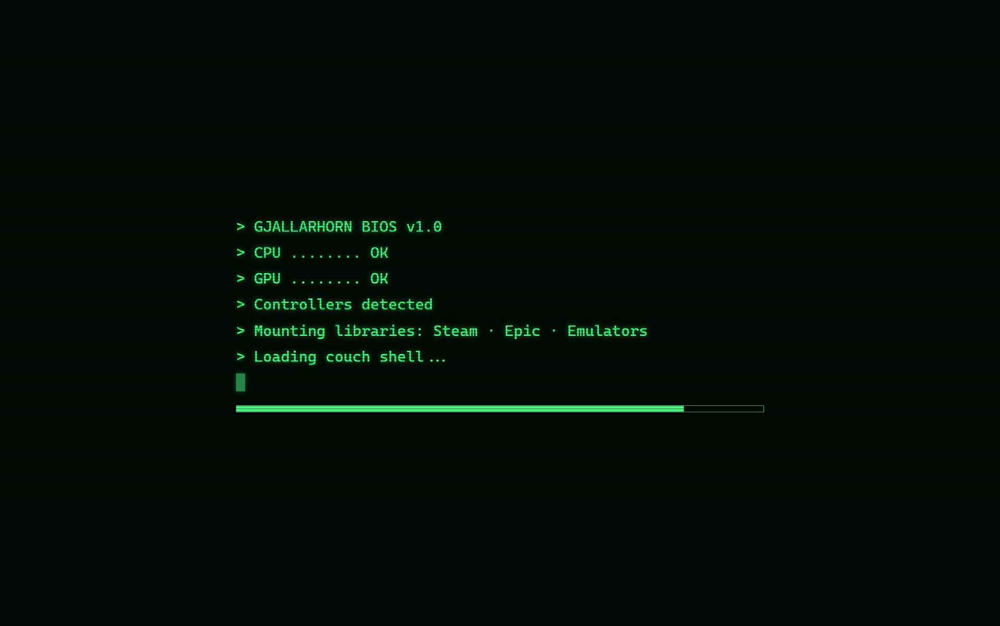
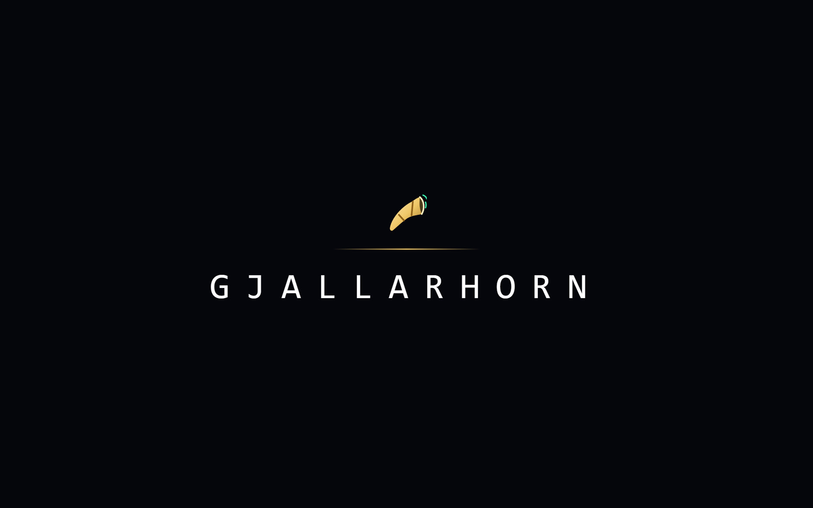

---

## Desktop extras

Price comparison across stores, free games, a wishlist with price-drop alerts, bundles, a storage manager, the OptiScaler helper, per-game tweaks with backup and restore, a global **quick launcher** (Ctrl + Shift + Space), a command palette, a "what should I play?" roulette, a tray icon, and an optional *AI / Gaming* switch that unloads local Ollama models from VRAM while a game runs.

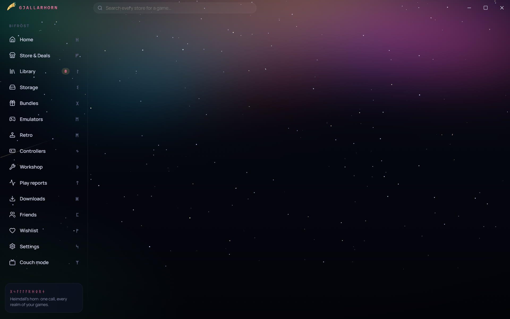
